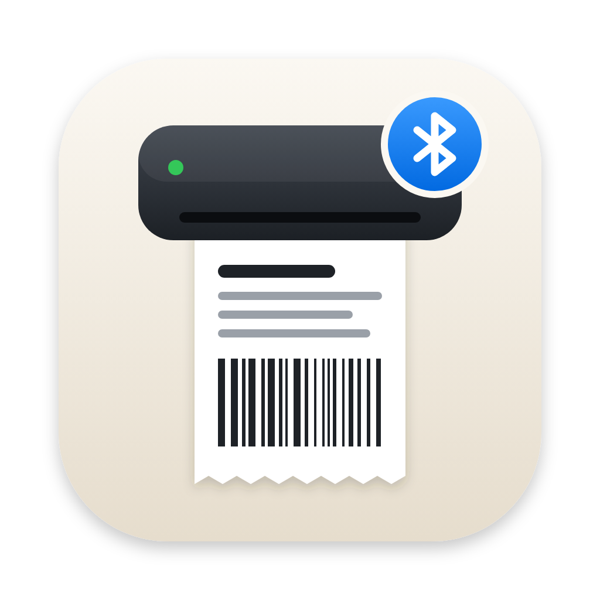
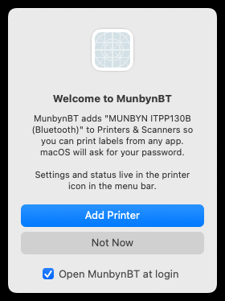
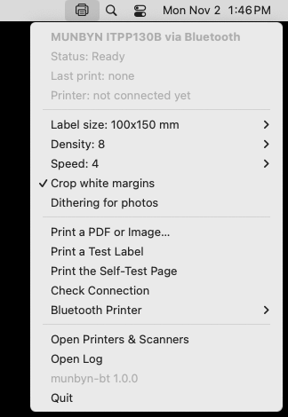
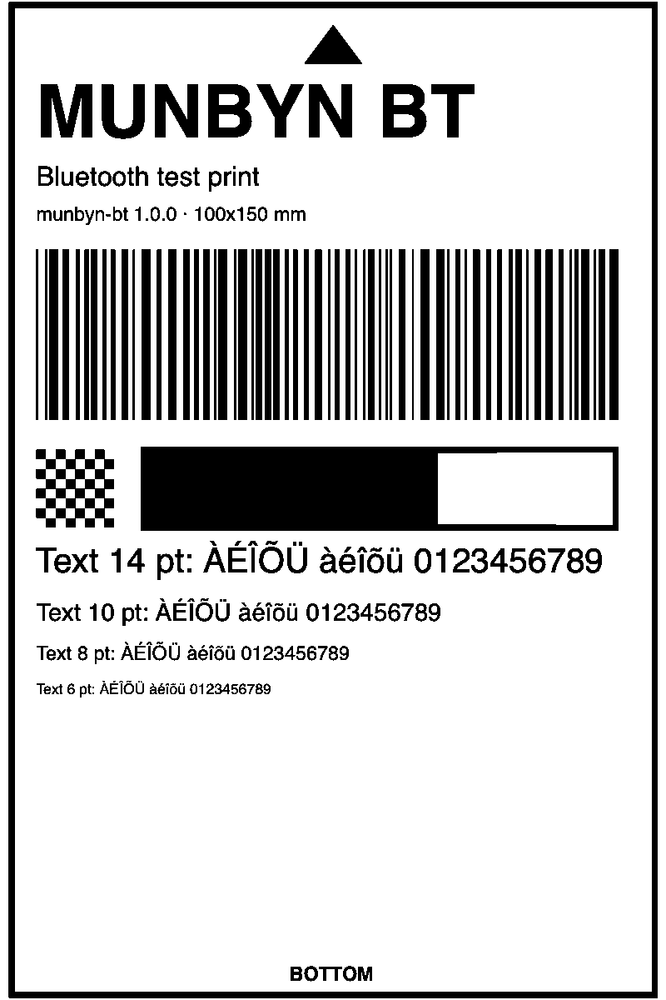

<p align="center"></p>

# MunbynBT

Print shipping labels from a Mac to a **MUNBYN ITPP130B** thermal printer over **Bluetooth**, from any app.

[](https://github.com/valeriodon/munbyn-bt/actions/workflows/build.yml)

**[Download the latest release](https://github.com/valeriodon/munbyn-bt/releases/latest)** · macOS 13 or later · Apple silicon and Intel

<p align="center">
  
  &nbsp;&nbsp;
  
</p>

> **Status: beta.** The Bluetooth link replicates MUNBYN Editor's protocol byte for byte. Everything around it is tested automatically on macOS, but real-hardware testing is still in progress.
> Unofficial project, not affiliated with or endorsed by MUNBYN.

---

## The problem

I bought a MUNBYN ITPP130B to print shipping labels for things I sell online. It's sold as a Bluetooth printer, and on a Mac that turns out to mean very little:

- MUNBYN's Bluetooth driver is **Windows only**. Pairing the printer in System Settings does nothing useful.
- On macOS, MUNBYN's answer is **MUNBYN Editor**, a web app that only works in **Chrome**. You upload your PDF there, crop it by hand and print.
- The fallback is a **USB cable**, which defeats the point of a wireless printer on a desk.

I didn't want a better label editor. I wanted the printer to behave like any other Mac printer: press ⌘P anywhere and get a label.

## What I designed

MunbynBT is a small menu bar app that turns the Bluetooth printer into a regular macOS printer:

- **"MUNBYN ITPP130B (Bluetooth)"** appears in Printers & Scanners and in every print dialog.
- **Shipping labels on A4 or Letter** are cropped, rotated and fitted to the label automatically.
- **A menu bar panel** shows the status and holds the few settings that matter.
- **Installation** is a DMG: drag to Applications, open it, click *Add Printer*.

## Key product decisions

### 1. Be a printer, not another app
**Options:**
- improve on MUNBYN Editor with a custom label app;
- build a "send to printer" utility with its own window;
- make the printer a real system printer.

**Choice:** a real CUPS printer. Every Mac app already knows how to print, and people already know how to use a print dialog. The best workflow is the one users don't have to learn.
**Trade-off:** a CUPS integration is more plumbing: a local queue, a PPD, a background process. In exchange the product has no UI for printing at all.

### 2. Copy the vendor's behaviour, don't guess it
Rather than sniffing Bluetooth traffic or trying commands until something printed, I studied MUNBYN Editor's web code. From it I took:
- the exact Bluetooth LE service;
- the TSPL commands;
- the bitmap polarity;
- the pacing: 180-byte chunks, one every 8 ms on a Mac.

The defaults also match it: density 8, speed 4, a 2 mm gap.
**Why:** the printer then receives exactly what its own software sends, so quality and reliability match what MUNBYN tested.
**Trade-off:** the app is tied to this model family's protocol, which is why it's scoped to the ITPP130B and says so.

### 3. Make A4 shipping labels just work
Marketplaces and carriers usually hand you a PDF on an **A4 or Letter page**, often with the label turned sideways in a corner. MUNBYN Editor asks you to crop it by hand every time. MunbynBT:
1. finds the non-white area of the page;
2. rotates it if its orientation doesn't match the label (clockwise, because labels laid sideways on A4 typically have their top on the left);
3. fits it to the label without distortion.

Because the PDF is still vector at that stage, the result is sharp, not an upscaled screenshot.
**Trade-off:** a design with intentional white margins would get enlarged. That's why *Crop white margins* is a visible toggle in the panel and not hidden behaviour.

### 4. One printer, and the paper size carries the intent
I first sketched two printers: one that prints the page as is, one that crops and fits. Two nearly identical entries in every print dialog is a choice users shouldn't have to make. Instead there is **one printer**, and the paper size you pick says what you mean:
- **a label size** (100x150 mm, 4x6 in, …) prints the page as it is;
- **A4 or Letter** crops and fits it onto your label.

Copies and scaling still work, because they come from the standard print dialog.

### 5. Settings live where the printer lives
I chose a **menu bar panel** over a preferences window:
- the status ("Printing 1 of 2 · 60%"), the last print and the connected printer are one click away;
- the settings that matter on a thermal printer (label size, density, speed, cropping, dithering for photos) are a single submenu each;
- changes apply to the next print without restarting anything;
- the icon changes while printing or when something goes wrong.

**Feedback rule:** success is silent, because the label coming out *is* the feedback. Errors raise a notification with a plain-language cause, for example "Printer not found: is it on and close to the Mac?".

### 6. No Terminal, no manual
The first version had an install script, which is fine for me and wrong for the people this is for. The released app installs itself on first launch:
1. a single welcome window explains what will happen;
2. one admin password prompt adds the printer;
3. "Open at login" is preselected but can be unticked, and also toggled later from the panel.

The Bluetooth permission prompt carries a plain explanation. The app also remembers the printer it last used, and *Search for Nearby Printers* covers the rare case of more than one.

### 7. Verifiable without the hardware
Bluetooth can't run in CI, so I made everything around it testable. Every push builds the app on a macOS runner and then:
- renders test labels and decodes the generated TSPL back into images to check them pixel by pixel;
- sends PDFs through a **real CUPS queue**, including multiple copies;
- takes screenshots of the panel and of the first-run window.

The test label itself is designed to make problems visible on paper:
- an arrow says which way is up;
- a checkerboard and a gray scale show density and dithering;
- text from 14 down to 6 pt shows legibility.

### How I built it
I defined the product, made the decisions above and reviewed every iteration. The implementation was done with **Claude Code** as an AI coding agent: reading the vendor's web app, writing the Swift code and running the CI feedback loop. For me that's the interesting part of AI-assisted product work. The fast loop of *decide, build, look at the evidence, adjust* is what turned a frustrating purchase into a finished, installable product in a day.

## What I'd do next
- Confirm and tune on more hardware, then open it to other MUNBYN Bluetooth models that use the same protocol (ITPP941B, RW411B).
- Read the printer's status (paper out, cover open) to warn before printing instead of after.
- An Italian localization of the panel and the first-run window.
- Drag and drop a PDF onto the menu bar icon to print it.

---

## Install

1. Download `MunbynBT-x.y.z.dmg` from [Releases](https://github.com/valeriodon/munbyn-bt/releases/latest) and drag **MunbynBT** to **Applications**.
2. Open it, click **Add Printer** and enter your Mac password. Allow Bluetooth when macOS asks.
3. If you had paired the printer in System Settings › Bluetooth, remove it there: MunbynBT connects on its own.
4. Turn the printer on and print from any app to **MUNBYN ITPP130B (Bluetooth)**.

If a release is marked as not notarized, macOS blocks the first launch. In that case go to System Settings › Privacy & Security and click **Open Anyway**.

### Build from source
You need the Xcode command line tools (`xcode-select --install`).

```bash
git clone https://github.com/valeriodon/munbyn-bt.git
cd munbyn-bt
./install.sh
```

## Use

- **Any app:** File › Print › *MUNBYN ITPP130B (Bluetooth)*. Pick your label size to print as is, or A4 / Letter to crop and fit.
- **Menu bar panel:**
  - status, label size, density, speed, cropping, dithering;
  - print a PDF or image, print a test label or the printer's self-test page;
  - check the connection, pick a printer, open the log.
- **Command line:** `munbyn-bt print label.pdf`, `munbyn-bt test`, `munbyn-bt scan`. Run `munbyn-bt help` for the options.

The log is in `~/Library/Logs/munbyn-bt.log`.

## How it works

The CUPS queue uses a pass-through PPD and the `socket://127.0.0.1:9100` backend, so the PDF reaches the MunbynBT app unchanged. MunbynBT then:

1. renders each page at 203 dpi in black and white (cropping, rotating and fitting as needed);
2. sends it over Bluetooth LE exactly like MUNBYN Editor:
   - TSPL commands (`SIZE`, `GAP`, `SPEED`, `DENSITY`, `BITMAP`, `PRINT`), where a 1 bit in the bitmap is white;
   - written without response to the ISSC "transparent UART" service `49535343-FE7D-4AE5-8FA9-9FAFD205E455`;
   - in 180-byte chunks, one every 8 ms.



**Code map:**

| File | What it does |
| --- | --- |
| `src/Render.swift` | PDF and image rendering, cropping, rotation, 1-bit conversion, TSPL |
| `src/BLE.swift` | Bluetooth LE connection and paced writes |
| `src/Server.swift` | Local socket that receives jobs from CUPS |
| `src/MenuBar.swift` | Menu bar panel |
| `src/Setup.swift` | First-run window, printer queue, login item |
| `src/PPD.swift` | Label sizes and the CUPS PPD |
| `src/TestPDF.swift` | Test label |
| `.github/workflows` | CI tests and the signed DMG release |

## Uninstall

Quit MunbynBT from its menu, remove *MUNBYN ITPP130B (Bluetooth)* in Printers & Scanners and delete the app. From a clone of the repo, `./uninstall.sh` does all of it.

## License

MIT, see [LICENSE](LICENSE).
